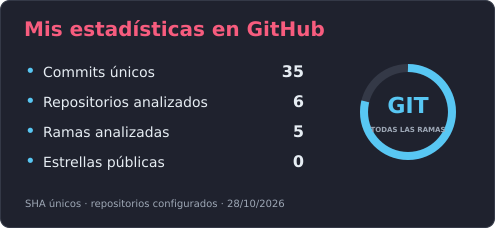
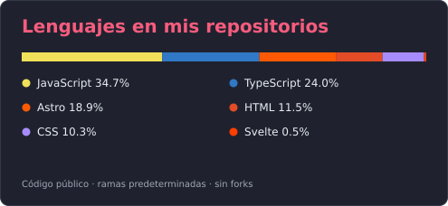
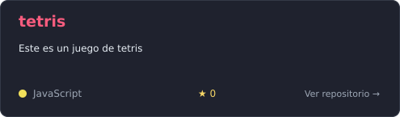
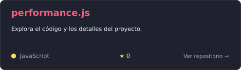
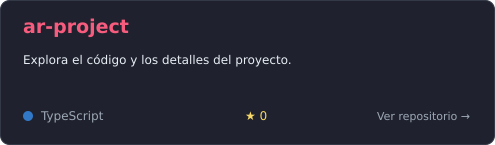
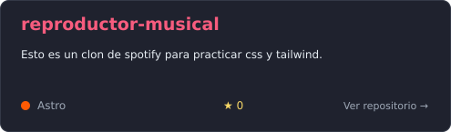
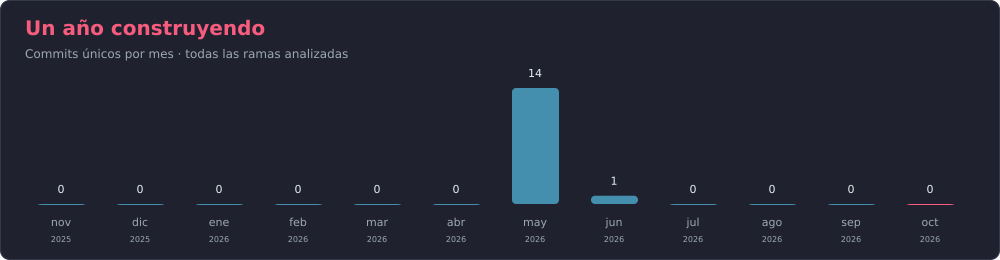

  

  

  
  
  

 

  
  

 

  
<h2>📘 Mis proyectos</h2>

  

    
    
  

  

    
    
  

  

  
<h2>🛠️ Tecnologías y herramientas</h2>

  <h3>👨‍💻 Lenguajes</h3>

  

    
    
    
    
    
    
  

  <h3>🧰 Frameworks y librerías</h3>

  

    
    
    
    
    
  

  <h3>🗄️ Backend y bases de datos</h3>

  

    
    
    
    
    
  

  <h3>💻 Herramientas</h3>

  

    
    
    
  

  
<h2>📊 Actividad</h2>

  

    
  

  Los commits se cuentan una sola vez por SHA, aunque aparezcan en varias ramas o repositorios. El conteo considera las ramas existentes de los repositorios configurados. Los lenguajes representan el código de las ramas predeterminadas de los repositorios públicos propios que no son forks.

